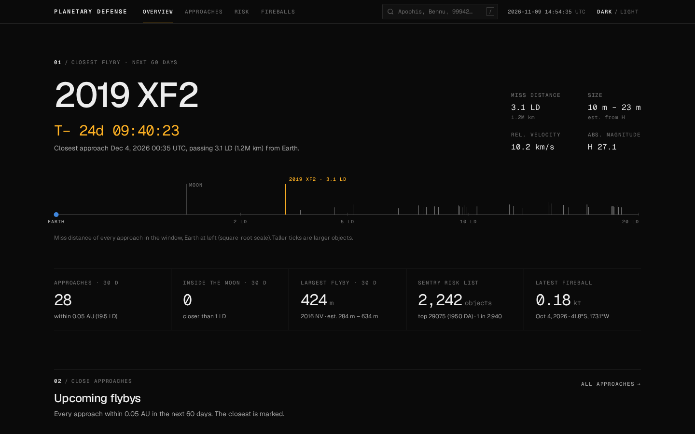
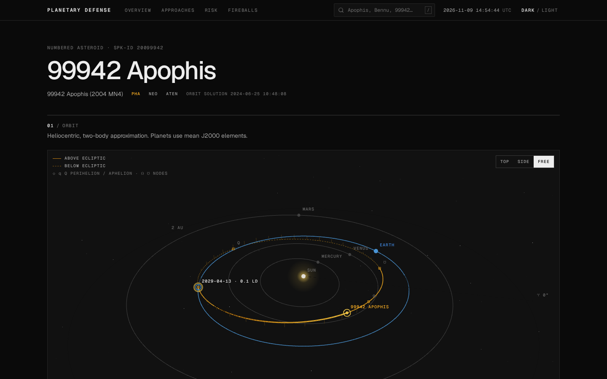
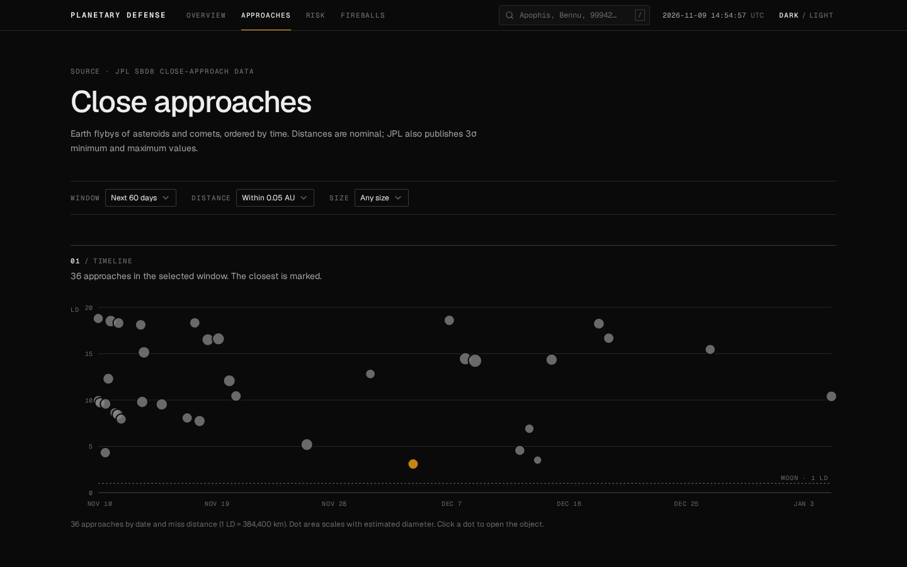

# Planetary Defense Dashboard

[](https://github.com/ljivesh/planetary-defense/actions/workflows/ci.yml)


[](LICENSE)

Track near-Earth objects using public NASA/JPL data. The dashboard shows upcoming
close approaches, the Sentry impact-risk table, object profiles with a 3D orbit
viewer, and fireball (bolide) events.

**Live demo:** https://planetary-defense.menma.me



| 3D orbit viewer (99942 Apophis) | Close approaches, next 60 days |
|---|---|
|  |  |

- **Frontend:** React 19 · TypeScript 7 · Vite 8 · Tailwind CSS v4 · shadcn/ui (Radix) · TanStack Query & Table · React Router 8 · Recharts · react-three-fiber · zod
- **Backend:** Go 1.26 · chi · otter (TTL cache with load coalescing) · slog · caarlos0/env
- **Design:** an "instrument data sheet" system (near-black canvas, hairline rules, mono figures, one amber signal colour), specified in [`docs/DESIGN.md`](docs/DESIGN.md). Read it before changing UI.

```
┌───────────────┐   /api/v1/*   ┌──────────────────────────┐   HTTPS   ┌──────────────────────┐
│ React (Vite)  │ ────────────▶ │ Go API                   │ ────────▶ │ ssd-api.jpl.nasa.gov │
│ :5173         │ ◀──────────── │ cache · normalize · CORS │ ◀──────── │ cad / sentry / sbdb  │
└───────────────┘   typed JSON  └──────────────────────────┘  fields+  │ fireball             │
                                                              data[][] └──────────────────────┘
```

The Go service puts a cache in front of JPL. It turns JPL's column-oriented
`fields` + `data[][]` responses into typed camelCase JSON, adds derived values
(size estimated from H, merged SBDB and Sentry profiles), and gives clean error
semantics. The frontend validates every response with zod.

## Quick start

Prerequisites: Go ≥ 1.26 (an older Go downloads the right toolchain automatically), Node ≥ 22, pnpm ≥ 10.

```bash
make install      # go mod download + pnpm install
make dev          # API on :8080 (live reload via air) + web on :5173
```

Open http://localhost:5173. No API keys are needed because the JPL SSD APIs are public.

Other targets: `make test`, `make test-e2e`, `make lint`, `make build`, `make fmt` (`make help` lists them all).

## Testing

Three layers, all runnable offline and all run in CI ([`.github/workflows/ci.yml`](.github/workflows/ci.yml)):

| Layer | What it covers | Command |
|---|---|---|
| Go unit and handler tests | JPL decoding against recorded fixtures, the cache (TTL and load coalescing), the domain service (merging SBDB + Sentry, summary maths), HTTP param validation and error mapping. Run with the race detector. ~72% statement coverage. | `make test-api` |
| Vitest | Formatting, Kepler propagation and orbit geometry on the frontend. | `make test-web` |
| Playwright end-to-end | The real stack: browser → Vite → Go API → a fake JPL server (`backend/cmd/fakejpl`) that serves the same recorded fixtures. Covers the overview, navigation, close-approach and risk tables, search into an object with the 3D orbit, a 404 from the API, and unknown routes. | `make test-e2e` |

The fake JPL server is also handy for local work without hitting NASA:
`go run ./cmd/fakejpl` and start the API with `JPL_BASE_URL=http://localhost:9090`.

## Design decisions

- **A thin Go service in front of JPL instead of calling it from the browser.** JPL returns column-oriented
  `fields` + `data[][]` with numbers as strings. Decoding that once on the server gives the frontend typed,
  stable camelCase JSON and keeps JPL's quirks in one package (`internal/jpl`).
- **Cache with load coalescing.** JPL data changes slowly, so responses are cached per endpoint (1 h to 24 h).
  When many requests miss the same key at once they share one upstream call, which keeps us polite to a
  public API and fast under load.
- **Validate at the boundary on both sides.** The API validates query params and maps upstream failures to
  clear error codes. The frontend parses every response with zod, so a contract change fails loudly in one
  place instead of rendering `NaN` somewhere.
- **Feature folders on the frontend.** Each feature owns its schema, query options, hooks and components, so
  adding a view rarely touches shared code.
- **Two-body orbits, on purpose.** Keplerian propagation is accurate enough to show where an object is and
  how its orbit sits against Earth's, without pulling in an ephemeris library. The limits are noted below.

## API

All endpoints are `GET` and return `{ "data": … }`. Errors return `{ "error": { "code", "message" } }`.

| Endpoint | Description |
|---|---|
| `/api/v1/health` | Liveness |
| `/api/v1/summary` | KPIs: next-30-day approaches, closest/largest flyby, Sentry count and top risk, latest fireball |
| `/api/v1/close-approaches?from=&to=&maxDistAu=&minDiameterM=&limit=` | Earth close approaches (defaults: next 60 days, ≤ 0.05 AU) |
| `/api/v1/risk?limit=` | Sentry risk table sorted by cumulative Palermo scale |
| `/api/v1/objects/{des}` | SBDB orbit and physical data, merged with the Sentry assessment |
| `/api/v1/objects/{des}/close-approaches` | Encounters within 0.2 AU, 1900–2200 |
| `/api/v1/fireballs?limit=` | Most recent fireball events |

Upstream responses are cached in memory: close approaches for 1 h, Sentry and fireballs for 6 h, SBDB for 24 h.
Concurrent requests for the same uncached key share a single upstream call.

### Configuration (env)

See `backend/.env.example`: `ADDR`, `APP_ENV`, `LOG_LEVEL`, `CORS_ORIGINS`, `JPL_BASE_URL`,
`UPSTREAM_TIMEOUT`, `REQUEST_TIMEOUT`, `RATE_LIMIT_PER_MIN`, `TRUSTED_PROXIES`.

## Project structure

```
backend/
  cmd/server/            entrypoint: config, wiring, graceful shutdown
  cmd/fakejpl/           serves recorded JPL fixtures (offline dev and e2e)
  internal/config/       env config
  internal/jpl/          typed JPL SSD client (cad, sentry, sbdb, fireball) + fixtures
  internal/neo/          domain models, service (caching, merging, summary), physics helpers
  internal/cache/        generic otter-backed TTL cache with load coalescing
  internal/httpapi/      chi router, middleware, handlers, param validation, error mapping
frontend/src/
  app/                   app root, providers, router, theme
  components/ui/         shadcn/ui primitives (generated)
  components/layout/     app shell, masthead (nav, "/" search, UTC clock, theme switch), page header
  components/common/     Section, Readout, RiskMark, DataTable (TanStack Table v9), PlainTable, chart theme, states…
  features/<feature>/    schemas.ts (zod) · api.ts (query options) · hooks/ · components/
                         close-approaches · risk · objects · orbit · fireballs · summary
  hooks/                 useUrlState, useDebounce, useMediaQuery, useTheme
  lib/                   api-client, query-client, format, orbital (Kepler), constants
  pages/                 route components (lazy-loaded)
frontend/e2e/            Playwright end-to-end tests (real stack, fake JPL)
docs/DESIGN.md           the visual system: tokens, type, components, data-viz and 3D rules
docs/IDEAS.md            the other brainstormed project ideas and the roadmap
```

## Notes on the science

- **Lunar distance (LD):** 1 LD = 384,400 km ≈ 0.00257 AU.
- **Size from H:** if no measured diameter exists, size is estimated as D = 1329 km / √p · 10^(−H/5)
  with albedo p between 0.05 and 0.25. That gives a range, not a single number.
- **Palermo scale:** log₁₀ of the hazard relative to the background impact risk. Below −2 means
  no likely consequence; −2 to 0 merits monitoring; above 0 is of concern. **Torino** (0–10) is the public scale.
- **Orbit viewer:** two-body Keplerian propagation from SBDB osculating elements. Planets use JPL's mean
  J2000 elements (Standish). The orbit is drawn solid above the ecliptic and dashed below, with drop lines,
  nodes (☊ ☋), perihelion/aphelion (q/Q) and the next Earth encounter. It is fine for visualization, not for
  precise ephemerides (planetary perturbations are ignored).

## What I'd do next

- Persist a daily snapshot of the close-approach list so the dashboard can show how an object's
  predicted miss distance changes as JPL refines its orbit.
- Server-sent events for the "T−" countdown and new fireballs instead of polling.
- Deploy behind a CDN with the API on a small container (the Dockerfiles are ready).

## Data credits

NASA/JPL Solar System Dynamics and CNEOS: [SSD APIs](https://ssd-api.jpl.nasa.gov/).
Fireball data comes from US Government sensors, via JPL.

## License

[MIT](LICENSE). Data is provided by NASA/JPL and is not covered by this license.
